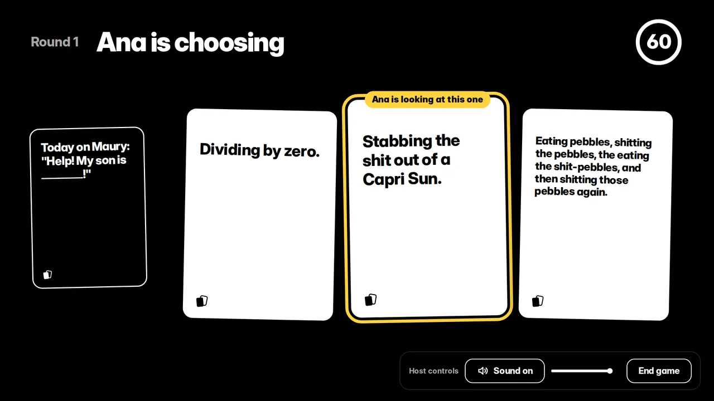
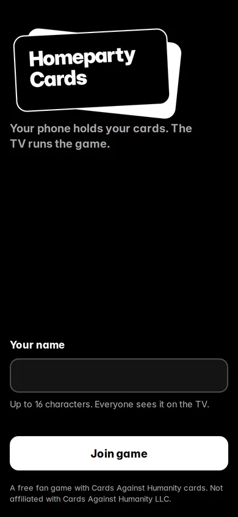
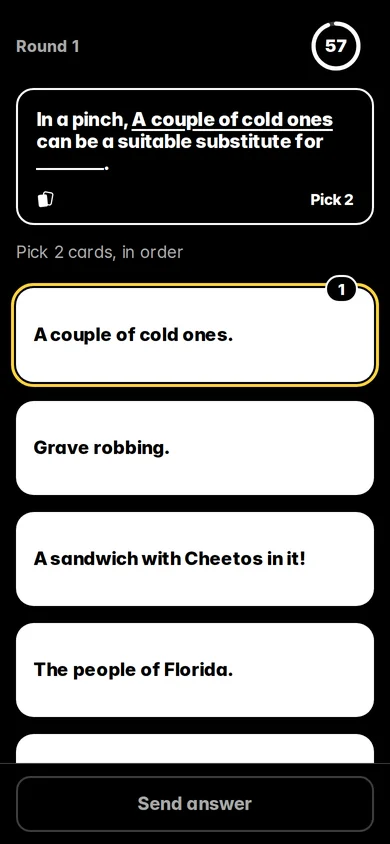
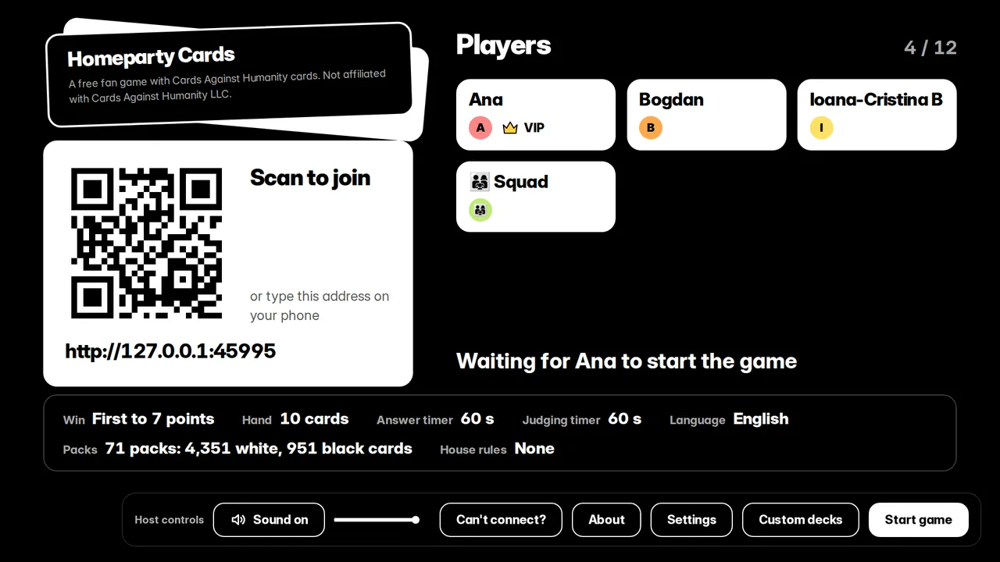
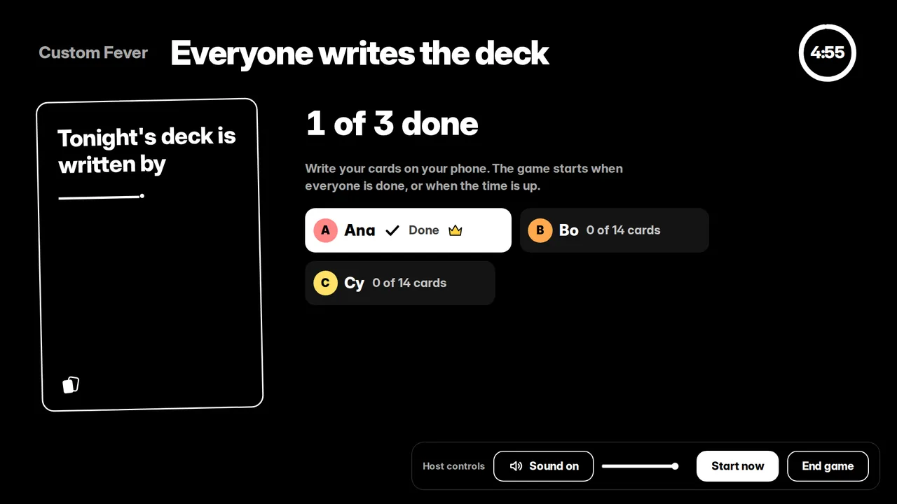

<p align="center">
  
</p>

<h1 align="center">Homeparty Cards</h1>

<p align="center">
  <b>The party game for horrible people, played on your own Wi-Fi.</b><br>
  One laptop is the TV. Everyone else plays from their phone's browser: no app, no accounts, no internet.
</p>

<p align="center">
  <a href="https://github.com/cotigamihnea/homeparty-cards/releases/latest"><b>Download for Windows</b></a>
  &nbsp;|&nbsp; <a href="#how-a-game-goes">How to play</a>
  &nbsp;|&nbsp; <a href="#custom-fever">Custom Fever</a>
  &nbsp;|&nbsp; <a href="#troubleshooting">Troubleshooting</a>
  &nbsp;|&nbsp; <a href="#credits-and-licences">Credits</a>
</p>

> [!NOTE]
> Homeparty Cards is a **free fan game**. It plays with the card text of Cards Against Humanity, which Cards Against Humanity LLC shares under a [Creative Commons BY-NC-SA](LICENSE-CARDS.md) licence. It is **not affiliated with or endorsed by Cards Against Humanity LLC**, and it will never be sold. The cards are crude and offensive by design: play with people who signed up for that.

## Why it's fun

- **The TV tells the story.** Black cards land on the table, every answer is dealt in face up as a real white card, the Card Czar's pick lights up as they browse, and the winner gets confetti. The game ends with a podium and a reel of the best combos.
- **Phones are the controllers.** Scan the QR code, type a name, and you're in. Your hand stays on your phone. Phones fall asleep at parties; when they wake up, you're still in your seat.
- **Write your own deck.** Make custom decks on your phone or the laptop and share them as files. Or play **Custom Fever**, where everyone writes the deck before the game starts.
- **Your rules.** Points to win (or a round limit with sudden death), hand size, timers, any of the 205 card packs, and six classic house rules, including Rando Cardrissian.
- **Made for a living room.** Huge type for the couch, big buttons for thumbs, sound on the TV, and English or Romanian.

<table>
  <tr>
    <td align="center" width="25%"><br><sub>Join from any phone</sub></td>
    <td align="center" width="25%"><br><sub>Your hand, in your hand</sub></td>
    <td align="center" width="50%"><br><sub>The lobby on the TV</sub></td>
  </tr>
</table>

## Get started

You need a Windows laptop (or any computer that runs Node.js), a TV or monitor to show it on, 3 to 12 players with phones, and one Wi-Fi network for everyone.

1. Download `Homeparty-Cards-<version>-win.zip` from the [latest release](https://github.com/cotigamihnea/homeparty-cards/releases/latest).
2. Extract it anywhere, open the folder and double-click **`Homeparty Cards.exe`**.
   - The app isn't code-signed, so Windows SmartScreen may warn you: choose **More info → Run anyway**.
   - When Windows Firewall asks, allow access on **Private networks**.
3. Put the window on the TV (**F11** for fullscreen). It shows a QR code and an address like `http://192.168.1.23:4242`.
4. Everyone joins the **same Wi-Fi**, then scans the QR code or types the address into their phone's browser.

Nobody can join? See [Troubleshooting](#troubleshooting). The game also opens a **Can't connect?** help screen by itself when the lobby stays empty for a minute.

## How a game goes

1. **Join.** The first player gets the **VIP crown** and runs the game from their phone: settings, packs, start and end. The laptop has the same controls, and the crown can be passed on.
2. **Answer.** Each round, one player is the **Card Czar**. The TV shows a black card, and everyone else picks the funniest white card (or two, or three) from the hand on their phone.
3. **Judge.** The TV reads the answers out one by one, anonymously. The Czar picks the winner on their phone, and the winner gets an **Awesome Point**.
4. **Win.** The first player to the target score wins, or the one with the most points after the round limit, with sudden death for a tie. Then **Play again**, or go back to the lobby.

Players can join in the middle of a game; they're dealt in at the next round. Dropped phones keep their seat, and the game pauses if fewer than 3 players are left.

### House rules

All are off by default; the VIP turns them on in the settings.

| Rule | What happens |
|---|---|
| **Rebooting the Universe** | Once a round, spend a point to swap your whole hand. |
| **Rando Cardrissian** | A bot plays a random card every round. If it wins, everyone shares the shame, and it can win the game. |
| **Happy Ending** | When the game is decided, one last round with "Make a haiku.", just for glory. |
| **Never Have I Ever** | Once a round, discard a card you don't understand. The TV shows it, with your name. |
| **Blank cards** | Start with up to three blank cards and write your own answers. |
| **Auto-play on timeout** | When the answer timer runs out, a random card is played for anyone who hasn't answered. |

## Custom Fever

<p align="center">
  
</p>

Choose **Custom Fever** as the game mode, with a writing time of 1 to 10 minutes (or no limit), and start the game:

- **Everyone writes.** Each phone gets a quota: a hand plus 3 white cards (13 with the usual 10-card hand), and about 12 black cards shared out (2 to 4 each). You can edit or remove your cards until writing ends. The TV only shows how far everyone has got, never what they wrote.
- **Writing ends** when everyone is done, when the time runs out, or when the VIP taps **Start now**. Missing cards are filled in from the selected packs, so the game always starts.
- **Then you play your own cards,** with every usual setting and house rule. Nobody can tell who wrote which card.
- **Keep the good ones.** At the end, the VIP can save the cards as a custom deck. **Play again** starts a fresh round of writing.

## Custom decks

The VIP's phone (**Custom decks** in the lobby) and the laptop's host controls can make decks of your own:

- **Write cards.** White cards are answers, up to 80 characters. Black cards are prompts, up to 200 characters: tap **Add blank** for each blank (up to 3), and the number of blanks is the Pick.
- **Edit them in the lobby:** rename a deck, fix or remove cards. Every change is saved at once.
- **Share them.** **Export** saves a deck as `<name>.cah-deck.json`, and **Import a deck file** adds one. Cards that break a rule or repeat are left out, and you're told how many.
- **Play them.** Your decks come first in the pack picker, with a **Your decks only** button. A game with a custom deck needs only enough white cards for every hand plus 3 per player, and 10 black cards.
- **Where they're kept:** one file per deck, only on the laptop. In the Windows app that's `%APPDATA%\Homeparty Cards\custom-decks`, which survives updating to a new release. The laptop's Custom decks panel shows the folder.

## Troubleshooting

<details>
<summary><b>Phones get "Site can't be reached"</b></summary>

Windows is probably blocking the game.

1. Set your laptop's Wi-Fi network to **Private**, not Public (Settings → Network & internet → Wi-Fi → your network).
2. Search Windows for **Allow an app through Windows Firewall**, find **Homeparty Cards**, and tick **Private**. If you run from source, allow **Electron** or **Node.js** instead.
3. Check that the phones are on the same Wi-Fi as the laptop, not on mobile data or a guest network.

</details>

<details>
<summary><b>The address says 4243 (or higher) instead of 4242</b></summary>

Something else was already using port 4242 (often a second copy of the game), so the game moved to the next free port. The QR code always shows the right one. To choose a port yourself, set the `PORT` environment variable, for example `PORT=5000 npm start`.

</details>

<details>
<summary><b>Running from source inside WSL2, and phones can't connect</b></summary>

By default WSL2 sits behind a private NAT address (like `172.x.x.x`) that phones can't reach. The game warns you about this on the TV and in the console.

1. **Windows 11 22H2 or newer:** turn on mirrored networking. Create `%USERPROFILE%\.wslconfig` containing:
   ```ini
   [wsl2]
   networkingMode=mirrored
   ```
   Then run `wsl --shutdown` in PowerShell and reopen WSL.
2. If phones still can't connect, allow the port through the Hyper-V firewall for WSL (in an admin PowerShell):
   ```powershell
   New-NetFirewallHyperVRule -Name Homeparty-Cards -DisplayName "Homeparty Cards" -Direction Inbound -VMCreatorId '{40E0AC32-46A5-438A-A0B2-2B479E8F2E90}' -Protocol TCP -LocalPorts 4242
   ```
   Microsoft's [WSL networking docs](https://learn.microsoft.com/windows/wsl/networking) have the details.
3. **Windows 10 or NAT mode:** forward the port from Windows to WSL (admin PowerShell), using the address the game shows:
   ```powershell
   netsh interface portproxy add v4tov4 listenport=4242 listenaddress=0.0.0.0 connectport=4242 connectaddress=<WSL-IP>
   ```
   The WSL address changes when you reboot, so you'll need to redo this.

</details>

## Run from source

You need [Node.js](https://nodejs.org/) 22.12 or newer (24 recommended).

```bash
git clone https://github.com/cotigamihnea/homeparty-cards
cd homeparty-cards
npm install
npm start          # build, then open the desktop app
```

| Command | What it does |
|---|---|
| `npm run dev` | The server with hot reload. Open `http://localhost:4242/host` in a browser; phones on your Wi-Fi get hot reload too. |
| `npm run serve` | The built game without the desktop app. |
| `npm test` / `npm run test:e2e` | Unit tests / browser tests with several phones and the TV. |
| `npm run typecheck` / `npm run lint` | TypeScript and lint checks. |
| `npm run package` | The Windows zip, in `release/` (run it on Windows). |
| `npm run fetch-cards` | Refreshes the card data from JSON Against Humanity. The game itself never needs the internet. |

Windows and WSL each need their own `npm install`: don't share `node_modules` between them. When you run from source, `npm run dev` and `npm run serve` keep custom decks in `custom-decks/` in the project, while `npm start` uses the app-data folder.

**Releasing:** push a tag that matches the version in `package.json` (for example `git tag v0.1.0` then `git push origin v0.1.0`). GitHub Actions then tests the code on Windows, builds `Homeparty-Cards-<version>-win.zip` and attaches it to a GitHub Release.

<details>
<summary><b>How it's built</b></summary>

- **Server:** Node.js, Express and Socket.io, with typed events shared by the server and both clients. The server is authoritative: phones send intents, and each screen gets only what it may see (your hand stays on your phone, and answers stay anonymous until the result).
- **Game logic:** a pure, seeded TypeScript engine (`reduce(state, action)`), covered by Vitest, including property tests that no screen can leak a hand or an author.
- **Clients:** vanilla TypeScript and CSS, bundled with Vite. The TV and the phones are plain web pages.
- **Desktop app:** Electron, packaged with electron-builder.
- **Tests:** Vitest for the engine and the clients, Playwright for multi-phone games and the Electron app.

</details>

## Credits and licences

- **Card text:** by [Cards Against Humanity LLC](https://www.cardsagainsthumanity.com), released under [Creative Commons BY-NC-SA 2.0](https://creativecommons.org/licenses/by-nc-sa/2.0/).
- **Card data:** [JSON Against Humanity](https://github.com/crhallberg/json-against-humanity) by Chris Hallberg, which also collects fan-made packs from their authors. It is distributed under [CC BY-NC-SA 4.0](https://creativecommons.org/licenses/by-nc-sa/4.0/), and so is the data file in this repository.
- **Changes and conditions:** the changes the game makes to the cards, and what you must do if you copy them, are in [LICENSE-CARDS.md](LICENSE-CARDS.md). In short: credit the authors, never sell it, and share changes under the same licence.
- **Name:** "Cards Against Humanity" is a trademark of Cards Against Humanity LLC. Homeparty Cards is not affiliated with, endorsed by or sponsored by them.
- **Game code:** MIT licence, see [LICENSE](LICENSE). It is built on the engine of [Homeparty Mafia](https://github.com/cotigamihnea/homeparty-mafia).
- **Font:** [Inter](https://rsms.me/inter/) by Rasmus Andersson (SIL Open Font License 1.1).
- **Sound effects:** by [Kenney](https://kenney.nl) (CC0).

The same credits are in the app, under **About** in the host controls. If you hold rights in any of this content and want something changed, please [open an issue](https://github.com/cotigamihnea/homeparty-cards/issues).
